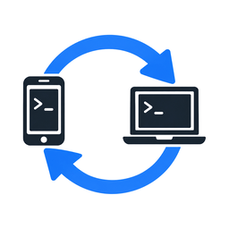
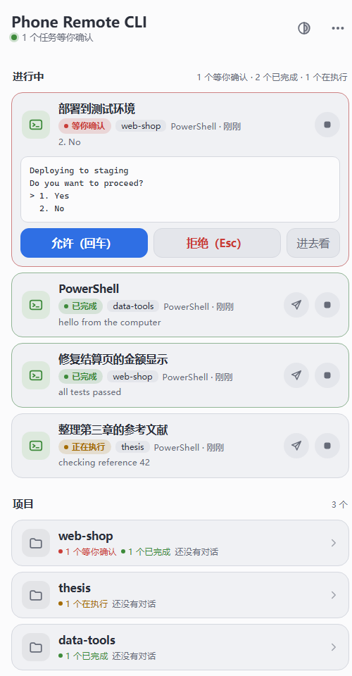
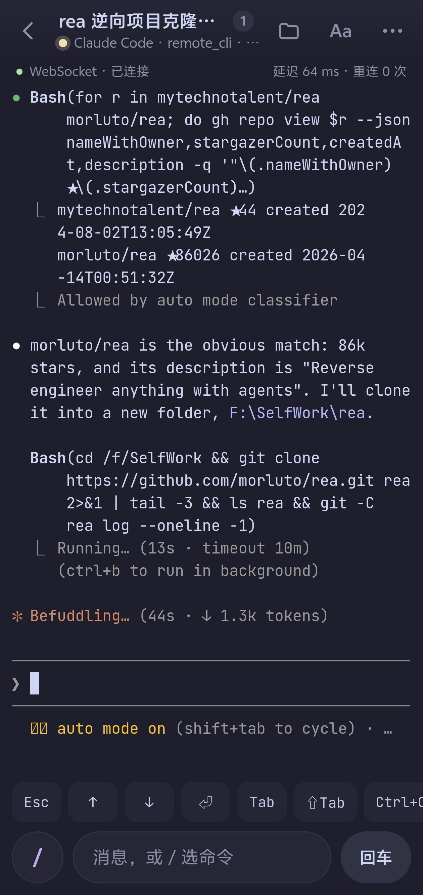
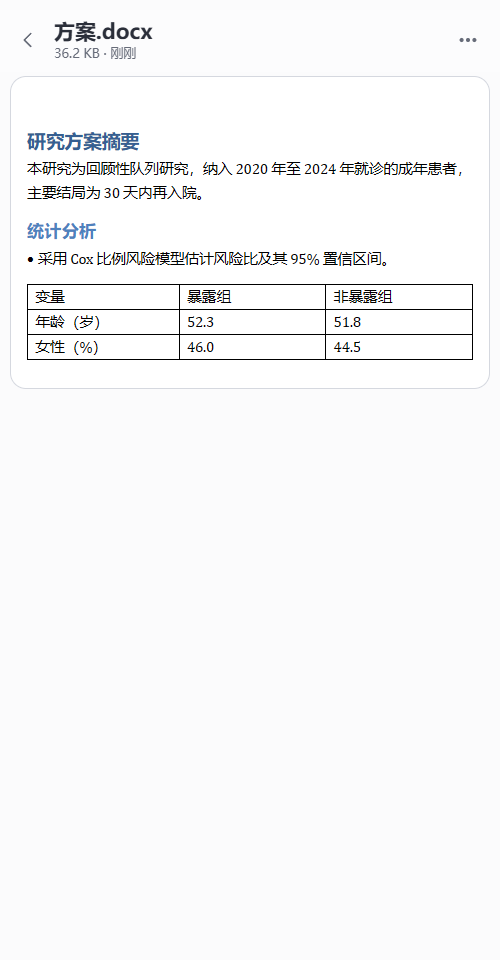
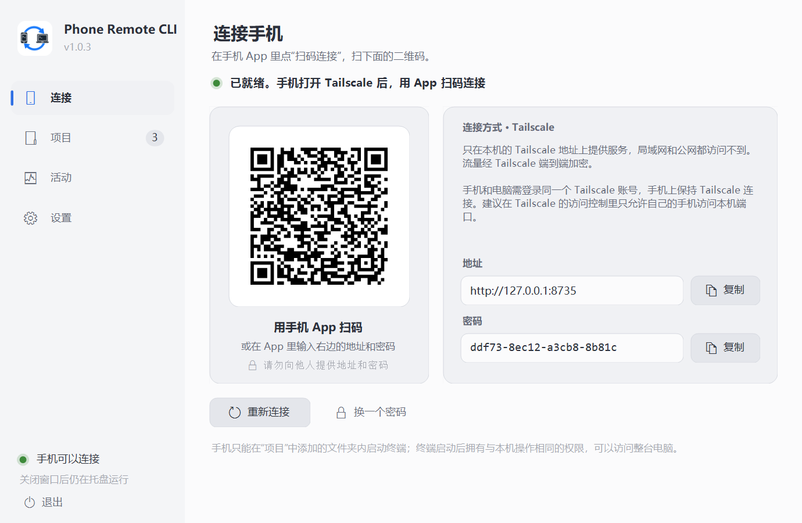
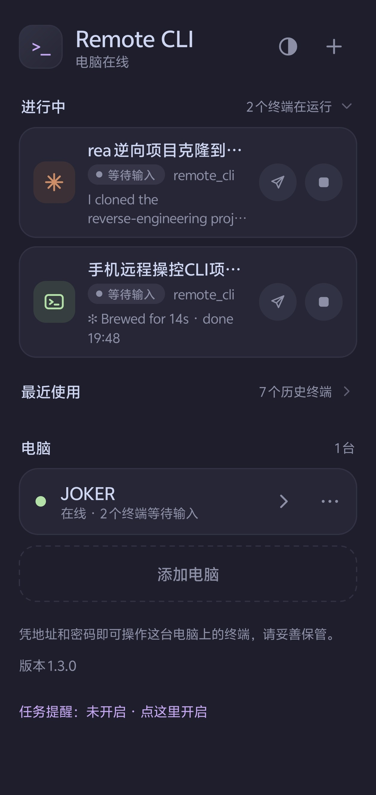
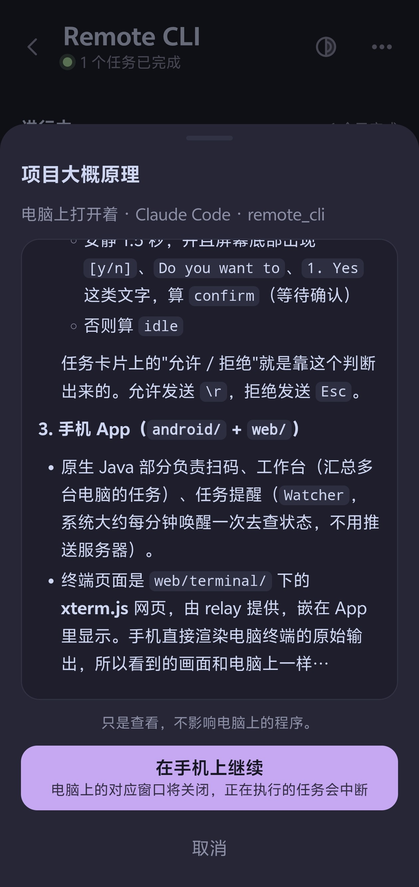
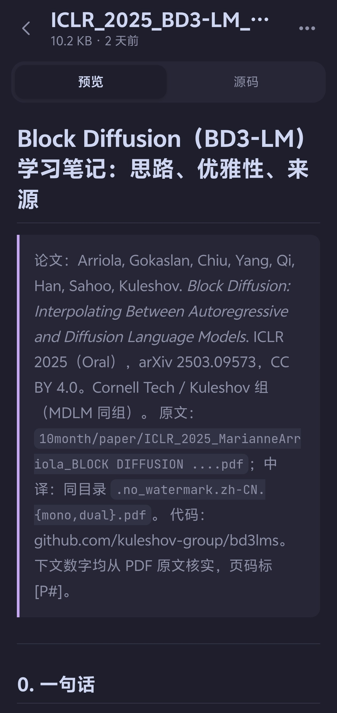
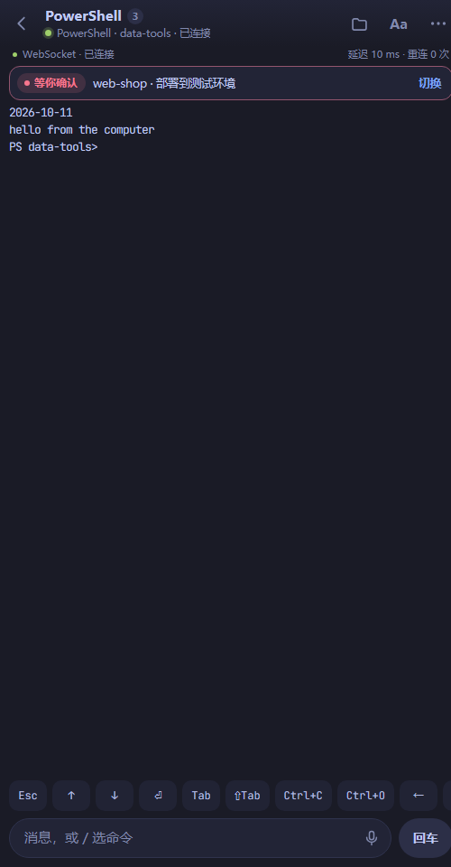

<div align="center">



# Phone Remote CLI

**躺在沙发上，用手机盯住电脑里的 Claude Code / Codex**

任务卡在“要不要允许”时，手机上点一下“允许”；跑完了，手机响一声；想补一句话，直接在手机上打字


### [⬇️ 在 Releases 页面下载电脑端和手机端](https://github.com/Joker-Cold/phone-remote-cli/releases)


&nbsp;

&nbsp;


</div>

## 💡 解决什么问题

Claude Code 和 Codex 跑长任务时，隔一会儿就停下来问一句“可以执行这条命令吗？”，做完一段又等你下一条指令。人一离开电脑，任务就干等着。

Phone Remote CLI 把电脑上的终端原样搬到手机上：

- ✅ **卡片上直接点“允许 / 拒绝”**：请求原文就显示在任务列表里，不用进终端
- 🔔 **等确认、跑完了，手机提醒你**：在工作台底部开启“任务提醒”即可
- ⌨️ **随时接着聊**：打开 App 就是终端当前的画面，能打字、能语音输入、能切到别的对话
- 🖥️ **手机和电脑共用一个终端**：两边看到的是同一个画面，谁都能输入，不用来回交接

它不提供模型，也不托管账号：启动的就是你电脑上已经装好的 `claude`、`codex` 和 PowerShell，用的是电脑本地的文件、配置和登录状态。

## ⚡ 三步用起来

1. **两端装 [Tailscale](https://tailscale.com)**，登录同一个账号
2. **电脑**：从 [Releases 页面](https://github.com/Joker-Cold/phone-remote-cli/releases) 下载 `phone-remote-cli.zip`，解压到任意位置，打开里面的 `RemoteCli.exe`，把项目文件夹拖进窗口
3. **手机**：从 [Releases 页面](https://github.com/Joker-Cold/phone-remote-cli/releases) 下载并安装 `phone-remote-cli.apk`，点“扫码添加电脑”，扫电脑窗口里的二维码

然后在项目里点“新建 Claude Code”“新建 Codex”或命令行就能开工；也可以从“历史对话”里挑一段接着做。

<p align="center"></p>

## ✨ 能做什么

| | |
| --- | --- |
| 🧑‍💻 **终端会话** | 电脑上 `claude`、`codex`、PowerShell 的真实画面，能输入、按键、回看；快捷键栏有 Esc、方向键、Tab、Shift+Tab、Ctrl+C、Ctrl+O 等 |
| 📜 **继续已有对话** | 列出 Claude Code 和 Codex 保存的对话，点一下接着聊；电脑上正开着的对话可以先看内容再决定要不要接手 |
| 🚦 **任务状态一眼看清** | 等待确认、已完成、正在执行、等待输入用不同颜色标出 |
| 💬 **快速指令** | 不进终端，在任务卡片上直接给它发一句话 |
| 🔔 **任务提醒** | 离开 App 后有任务等确认或跑完时发通知；通知栏里没有常驻图标 |
| 📂 **看项目文件** | 代码、Markdown、Jupyter 笔记本、表格、PDF、图片，Word 和 PowerPoint 带格式显示，可以存到手机 |
| ⚙️ **手机上改设置** | 不在电脑前也能改新终端的权限模式、开机自启 |
| 👆 **顺滑滚动** | 画面跟着手指走，松手有惯性；Claude Code 和 Codex 的全屏界面也一样 |
| 🎨 **六套配色** | 两套明亮、四套深色，字号行距可调，电脑端窗口跟着同一套配色 |

## 🖼️ 界面一览

| 工作台：所有电脑的任务都在这 | 电脑上开着的对话：先看再接手 |
| --- | --- |
|  |  |
| **Markdown / PDF 预览** | **深色外观** |
|  |  |

## 🔒 只走 Tailscale，没有第三方服务器

- 电脑端**只在 Tailscale 网卡的 `100.x.y.z` 地址上**提供服务，同一 Wi-Fi 里的其他设备和公网都访问不到；Tailscale 没连上就不启动
- 手机到电脑的流量由 Tailscale（WireGuard）端到端加密，不经过任何公共中转或隧道
- 密码随机生成，用 Windows DPAPI 加密保存；同一地址连续输错 6 次锁 15 分钟
- 文件查看只限已添加的项目文件夹，指向外部的链接不会被打开
- 电脑端和 App 都**不联网检查更新**，除了 Tailscale 内的连接没有别的外联

> ⚠️ 拿到地址和密码就能在你电脑上执行命令，请像 SSH 密钥一样保管。二维码里含密码，截图、共享屏幕时注意遮挡；怀疑泄露就在电脑端点“换一个密码”。
> 建议在 Tailscale 访问控制里只放行自己的手机访问 8722 端口，写法见 [使用说明](docs/GUIDE.md#第-3-步连上-tailscale)。

## ❓ 常见问题

**需要服务器或者公网 IP 吗？**
不需要。手机和电脑都连上 Tailscale 就行，两边直接通信。

**要付费吗？要我的 API Key 吗？**
都不要。它只是把你电脑上的 `claude` / `codex` 搬到手机上，额度和登录跟电脑上一样。

**手机上看到“电脑上正在使用”的对话，为什么不能直接输入？**
在电脑上单独打开的命令行窗口，手机只能看内容、不能接入。想两边共用，从手机或电脑端“活动”页新建终端；或者先结束电脑上那个窗口，再在手机上继续。

**通知为什么慢半拍？**
App 不用服务器推送，由系统大约每分钟唤醒一次检查，所以会晚几十秒到一分钟。部分手机要在系统设置里允许 App 后台运行。

**手机开了别的 VPN 能用吗？**
不行，Android 同时只能开一个 VPN，Tailscale 需要一直连着。

更多见 [常见问题](docs/FAQ.md) 和 [使用说明](docs/GUIDE.md)。

<details>
<summary><b>已知限制</b></summary>

- 电脑端仅支持 Windows 10 / 11（64 位），手机端仅支持 Android 8.0 及以上，界面仅中文
- Tailscale 无法直连、经其中继转发时，延迟会明显增加
- 最多同时运行 8 个终端
- Codex 的“另开一份继续”依赖支持 `fork` 的 Codex CLI
- 文件查看为只读，不能在手机上编辑、上传或删除；Word 和 PowerPoint 预览不分页，PowerPoint 的母版样式和图表可能与原文件有差异；旧格式 doc、ppt 不支持预览

</details>

---

## 🔧 进阶

<details>
<summary><b>从源码构建</b></summary>

```powershell
# 电脑端（两个 exe），只需要 Windows 自带的 .NET Framework 4.x
powershell -ExecutionPolicy Bypass -File agent-windows\build.ps1
# 便携版：使用 .cache 里官方的嵌入式 Python 并核对哈希，生成 dist\phone-remote-cli\ 文件夹和 dist\phone-remote-cli.zip
python tools\package_windows.py
# 安卓：JDK 11+ 和 Android SDK，不需要 Gradle，生成 dist\phone-remote-cli.apk
powershell -ExecutionPolicy Bypass -File android\build.ps1
```

目录结构、测试命令和版本号见 [构建和测试](docs/DEVELOPMENT.md)，三方之间的接口见 [PROTOCOL.md](docs/PROTOCOL.md)。

</details>

<details>
<summary><b>它是怎么连起来的</b></summary>

```
手机 App ──Tailscale 内的 HTTP / WebSocket──▶ 本机服务（只监听 Tailscale 地址） ◀── 电脑端程序（运行终端）
```

| 目录 | 内容 |
| --- | --- |
| `agent-windows/` | 电脑端窗口、托盘和终端代理（C#） |
| `relay/` | 本机服务：登录、HTTP 和 WebSocket（只用 Python 标准库，便携版内置嵌入式 Python） |
| `android/` | 安卓 App：工作台、扫码、任务提醒 |
| `web/` | 嵌在 App 里的列表页、终端页（xterm.js）、文件查看和电脑设置页，由电脑端提供 |

</details>

## 致谢与许可

- 基于 [KangWang42/remote-cli](https://github.com/KangWang42/remote-cli) 1.2.1 修改，感谢原作者
- MIT 许可，见 [LICENSE](LICENSE)（保留原项目的版权声明）；第三方组件见 [THIRD_PARTY.md](THIRD_PARTY.md)
- Claude Code 和 Codex 分别是 Anthropic 和 OpenAI 的产品，本项目只启动电脑上已安装的相应程序
